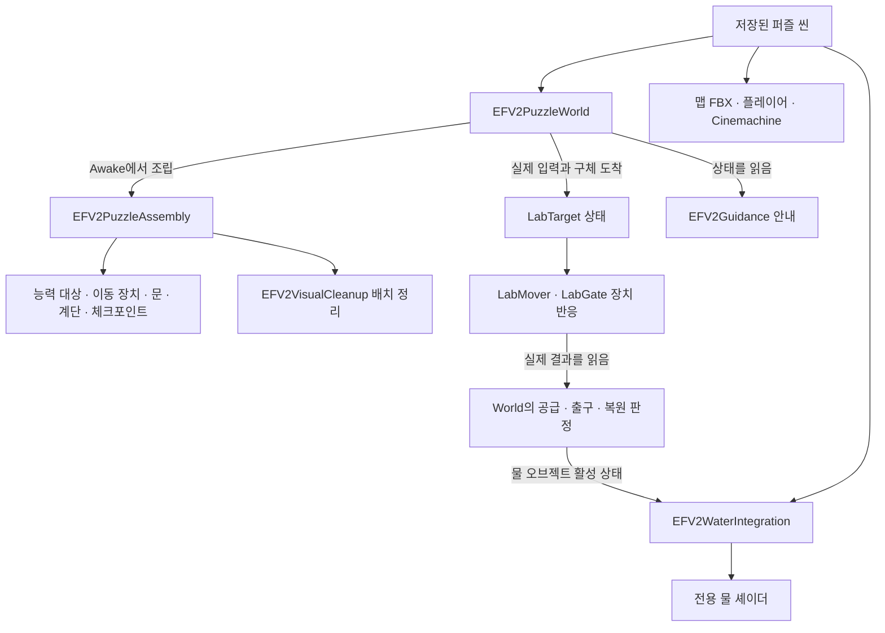

# EVERFLOW v2 퍼즐 씬 유지보수 안내

## 먼저 이해할 구조

이 프로젝트의 통합 씬은 **저장된 맵 위에 Play 시작 때 퍼즐을 코드로 조립하는 방식**이다. 배치, 게임 규칙, 화면 표현의 담당 파일을 구분하면 수정할 곳을 찾기 쉬워진다.

익숙하지 않은 용어는 다음 정도만 먼저 알면 된다.

| 용어 | 이 프로젝트에서의 의미 |
| --- | --- |
| GameObject | Hierarchy에 보이는 대상. 모델이 없는 기능용 대상도 있음 |
| Component | GameObject에 붙는 기능. 스크립트·Renderer·Collider 등이 해당 |
| Transform | 위치·회전·크기. 부모가 움직이면 자식도 그 영향을 받음 |
| Renderer / Collider | 화면에 그리는 기능 / 물리 충돌을 검사하는 기능. 따로 존재할 수 있음 |
| Trigger | 길을 막는 충돌 대신 진입·체류를 감지하는 영역. 체크포인트 등에 사용 |
| 런타임 | Play 중 실행되는 시간. 그때 생성한 대상은 Stop 후 보통 사라짐 |

사용할 씬: `Assets/Scenes/Everflow_Map_v2_test_with_puzzle.unity`

| 구분 | 저장된 씬 / 에셋 | Play 때 만들어지거나 바뀌는 것 |
| --- | --- | --- |
| 맵 | 팀원 FBX 인스턴스, 기존 모델, 플레이어·카메라 참조 | 일부 문·잎·발판을 이동용 부모 아래로 옮기고 충돌 연결 |
| 퍼즐 | `EFV2PuzzleWorld`의 맵/플레이어/시작점 참조와 기본 설정 | 능력 대상, 이동 레일, 문, 보조 계단·다리, 체크포인트, 구체 |
| 물 | `EVERFLOW Water Presentation`의 39개 구간 설정, 복제 메시·재질 | 실제 공급·동결 결과에 따라 표시와 애니메이션 갱신 |
| 안내 | 코드 안의 문구·표시 규칙 | `EFV2Guidance`가 생성되어 현재 목표·대상·물길 상태 표시 |
| 능력 이미지·시작 연출 | World에 붙은 `EFV2ScenePresentation`의 세 이미지, UV, 원경 위치·시선·시간 | 시작 전용 Cinemachine 카메라 생성 → 원경 3초 → 캐릭터 시점으로 1.25초 접근 → 기존 카메라에 조작 반환 |

**Play 전 Hierarchy와 Play 중 Hierarchy를 비교하는 것이 첫 실습이다.** Play 전에 안 보이던 퍼즐 오브젝트가 생성되는 이유를 여기서 확인할 수 있다.



화살표는 주된 연결을 요약한다. 플레이어 이동과 카메라, 장치 Update도 각자 실행되므로 모든 처리가 한 함수 안에서 순서대로 실행된다는 뜻은 아니다.

## 처음 20분, Unity에서 따라 보기

### 1. Play 전에 참조 확인

씬을 열고 `EVERFLOW V2.3 Puzzle World`를 선택한다. `EFV2PuzzleWorld`의 다음 항목을 본다.

- `Player`: 실제 이동하는 플레이어.
- `Map Root`: 모델을 찾을 기준인 FBX 인스턴스.
- `Spawn Point`: 시작과 전체 재시작의 기준.
- `Recall Distance`, `Cast Range`, `Orb Speed`, `Success Seconds`: 회수 거리·사거리·구체 속도·연속 공급 시간.

같은 오브젝트의 `EFV2ScenePresentation`은 능력 이미지와 시작 카메라 설정만 맡는다. `Ability Icons`는 원본 `Everflow_Map`의 이미지를 참조하며, 세 번째 원본 PULSE 이미지는 v2의 FLOW 설명으로 표시한다. 설명 문구·UI 위치는 `EFV2Guidance.DrawAbilities` / `AbilityDescription` / `Draw`에서 바꾼다. 목표와 물길 안내의 판정은 이 설정과 분리되어 있다.

`Overview Position` / `Overview Look At`은 월드 좌표이고, `Overview Seconds`는 원경 유지 시간, `Approach Seconds`는 캐릭터 시점까지 접근 시간이다. 실제 Camera를 직접 움직이는 스크립트를 추가하지 않는다. 기존 Cinemachine과 시작용 가상 카메라의 우선순위로 전환한다. 시작 중 Esc 일시정지는 연출도 멈춘다. Play를 다시 시작하면 원경부터 재생하며, 엔딩의 Enter 재시작은 기존처럼 즉시 시작 지점으로 돌아온다. 씬 생성 도구로 씬을 다시 만들었다면 `Tools → EVERFLOW → V2 Puzzles → Configure Ability Images And Opening`을 적용한다. 이 메뉴는 저장되지 않은 씬 변경이 있으면 중단한다.

이 값들은 씬에 저장되는 설정이다. 코드에 적힌 기본값과 Inspector에 저장된 값이 다르면 **이미 저장된 Inspector 값이 사용될 수 있다.**

### 2. Play 후 생성된 구조 찾기

Play를 누른다. World 아래의 `V2 Puzzle Runtime - model bindings and support geometry`를 펼친다.

| 이름 예시 | 역할 |
| --- | --- |
| `A ROOT STAIRS` | BLOOM을 받을 논리 대상 |
| `MOVING / PH_A_Leaf01` | 움직이는 잎의 부모. 모델과 충돌이 이 부모의 이동을 따라감 |
| `SAFE / ...` | 체크포인트 Trigger와 복귀 위치 |
| `SIGN / ...` | 현장 문구 |
| `ONE V2 ... ORB` | 능력별 실제 구체 하나 |

구체적인 이름으로 Hierarchy를 검색하면 찾기 쉽다. 이동 모델 일부는 원래 FBX 아래에서 이동용 부모 아래로 옮겨지므로, Play 전의 위치만 보고 누락됐다고 판단하지 않는다.

### 3. A 뿌리 하나만 관찰

1. `1`을 눌러 BLOOM을 선택하고 A 뿌리를 조준한다.
2. `A ROOT STAIRS`의 `LabTarget`을 Inspector에 띄운다.
3. 좌클릭하고 구체가 도착할 때 변화를 본다.
4. `LabTarget`의 직렬화된 `State`를 펼쳐 `grown` 변화와 생성 계단의 활성 상태를 비교한다.
5. 구체를 다른 대상으로 옮긴 뒤에도 계단이 남는지 본다.

이때 구분할 것은 **조준 대상, 구체, 성장한 길** 세 가지다. 같은 오브젝트가 전부를 담당하지 않는다.

### 4. D2에서 규칙과 표현 비교

지하에서는 HUD 오른쪽 물길 상태판을 본다. D2를 정비 부두 → 작은 수차 → 주 출구로 바꾸며, 표시와 실제 물길을 비교한다.

`Supply`, `Arriving`, `Restored`는 C# 읽기 전용 프로퍼티여서 기본 Inspector에 자동으로 노출되지 않는다. 해당 값은 HUD나 기존 브리지의 `inspect` 결과로 확인한다. 물 구간의 `clock`, `wet` 등 `[NonSerialized]` 실행 값도 일반 Inspector에 표시된다고 가정하지 않는다.

### 5. Stop 후 남는 것 확인

Play를 멈춘다. 런타임 계단·대상과 실행 중 값이 원래 상태로 돌아오는 것을 확인한다.

**Play 중 Inspector에서 값을 바꾸는 것은 실험용이다.** 유지하려는 변경은 Stop 후 씬 설정에 다시 반영하거나, 생성 코드를 수정해야 한다.

## 어떤 파일을 수정할지 찾는 표

| 바꾸려는 것 | 먼저 볼 파일 / 위치 | 확인할 점 |
| --- | --- | --- |
| 계단·다리·장치·체크포인트 위치 | [EFV2PuzzleAssembly.cs](../Assets/EverflowMap/Runtime/EFV2PuzzleAssembly.cs) | 지상은 `Surface`, 지하는 `Underground`, 출구·정원은 `Ending` |
| 모델 겹침·장식 위치·중복 바닥 정리 | [EFV2VisualCleanup.cs](../Assets/EverflowMap/Runtime/EFV2VisualCleanup.cs) | 생성 직후 적용되는 추가 정리. 남겨야 하는 지지면을 확인 |
| 구체 발사·도착·자동 회수·조준·복귀 | [EFV2PuzzleWorld.cs](../Assets/EverflowMap/Runtime/EFV2PuzzleWorld.cs) | `CanUse`, `TryCast`, `TickOrbs`, `Respawn` |
| D5 공급·D2 분기·W 성공 판정 | 같은 파일의 `TickCircuit` | 표현 쪽에 별도 공급 공식을 만들지 않기 |
| 능력별 구체의 소유/이동 상태 | [EFV2PuzzleState.cs](../Assets/EverflowMap/Runtime/EFV2PuzzleState.cs) | `EFV2OrbSlot`, 중복 도착 방지용 revision |
| 장치의 성장·동결·방향 상태 | [LabTarget.cs](../Assets/EverflowPuzzleLab/Runtime/LabTarget.cs), [LabState.cs](../Assets/EverflowPuzzleLab/Runtime/LabState.cs) | PuzzleLab과 공유하는 코드라는 점에 주의 |
| 이동 발판의 움직임 | [LabMover.cs](../Assets/EverflowPuzzleLab/Runtime/LabMover.cs) | 속도/레일의 개별 설정은 Assembly에서 먼저 조정 |
| 문 상승과 걸쇠 | [LabGate.cs](../Assets/EverflowPuzzleLab/Runtime/LabGate.cs) | 문이 완전히 열린 뒤 유지되는 상태 |
| HUD 문구·목표·도움말·한글 이름 | [EFV2Guidance.cs](../Assets/EverflowMap/Runtime/EFV2Guidance.cs) | `Refresh`, `names`, `SkinWorldSigns`, `DrawHelp` |
| 물 방향·속도·거품·물결 높이 | 씬의 `EVERFLOW Water Presentation` → Segments | 구간 Label로 찾고 Play를 끈 상태에서 조정 |
| 물 상태 연동 | [EFV2WaterIntegration.cs](../Assets/EverflowMap/Runtime/EFV2WaterIntegration.cs) | World의 실제 결과를 읽어 표현만 변경 |
| 물 공통 색·광택·무늬 크기 | `Assets/EverflowWater/Materials/EF_CoolWater.mat` | 구간별 PropertyBlock이 덮어쓰는 값과 구분 |
| 물 셰이더 계산 | [EF_CoolWater.shader](../Assets/EverflowWater/Shaders/EF_CoolWater.shader) | 속도/시간이 모두 같은 동결 제어를 따르는지 확인 |
| 이동·접지·발판 동승 | [EFMapPlayer.cs](../Assets/EverflowMap/Runtime/EFMapPlayer.cs) | 다른 씬에도 쓰는 공유 코드 |
| 플레이 카메라 | 씬의 Main Camera/FreeLook Camera와 Cinemachine | 카메라 Transform을 쓰는 별도 스크립트를 겹쳐 붙이지 않기 |

## 코드가 실행되는 흐름

1. **Awake:** World가 필수 참조를 확인하고 Assembly로 맵의 장치를 조립한다. 배치 정리를 적용하고 안내 컴포넌트를 붙인다.
2. **Start:** 시작 위치·카메라 입력·글꼴 등을 준비한다. 물 표현은 전용 메시/재질과 구간 설정을 연결한다.
3. **Update:** 기존 입력, 물 공급/성공 상태, 구체 이동, 이동 장치와 문 등이 갱신된다. `LabMover`는 실행 순서 -100, World는 300이다.
4. **LateUpdate:** 실제 카메라를 기준으로 World가 조준을 판독한다. World 순서는 300, 물 표현은 600, 안내는 800이다. 공급 판정 뒤에 표현이 그 결과를 읽도록 나눠져 있다.
5. **OnGUI:** 현재 상태를 안내 화면으로 그린다. 현재 HUD는 Guidance가 담당한다.

일반 MonoBehaviour의 모든 Awake는 Start 전에 끝난다. 같은 종류의 콜백 안에서 실행 순서가 작을수록 먼저 실행된다는 의미다. 다른 콜백까지 숫자 하나로 섞어 정렬하는 것은 아니다.

## A 퍼즐로 이해하는 입력부터 결과까지

```text
1 선택 → 마우스로 A 뿌리 조준 → 좌클릭
    World.LateUpdate: 레이캐스트로 대상 찾기
    World.CanUse: 능력·사거리·몸 앞 가림 확인
    World.TryCast: BLOOM 구체의 새 목적지 설정
    World.TickOrbs: 구체를 이동시킴
    구체 도착: LabTarget.Apply(Bloom)
    LabTarget.Refresh: grown 상태와 연결된 계단 활성화
    Guidance: 성장 완료와 다음 목표 표시
```

구체가 떠나는 것과 세계의 효과가 사라지는 것은 별개다. 구체는 다른 대상으로 이동하거나 플레이어에게 돌아와도 `LabTarget`의 `grown/frozen/direction`을 지우지 않는다.

특히 직접 검사 코드를 작성할 때 **`LabTarget.Apply(Freeze)`를 두 번 호출해도 해동되지 않는다.** Apply는 동결 상태를 설정한다. 해제는 `Undo(Freeze)`이며, 일반 게임 입력에서는 World가 현재 동결 상태를 읽어 해제로 연결한다.

## 물레방아가 도는 조건을 읽는 법

```text
정상 D5 공급 = 위치 정렬 + 회전 정렬 + 구조물 고정 + 내부 물 해동
Supply = 정상 D5 공급 또는 우회 뿌리 성장

Arriving = Supply
           그리고 D2가 주 출구 방향
           그리고 D4가 열림
           그리고 주 물길 얼음 없음

Arriving이 연속 3초 → Restored 확정
복원 후 정원 도착 → GardenReached
```

- D2 방향 번호는 **0 정비 부두 / 1 작은 수차 / 2 주 출구**다.
- D5의 `channelStructure.Frozen`은 구조물 고정, `upperIce.Frozen`은 내부 물 동결이다. 서로 다른 대상이다.
- D2의 `mainIce.Frozen`은 주 물길을 막는 얼음이다.
- D4는 뿌리 해법으로 공급 전에 열 수도 있다. 완전히 열린 문은 걸쇠로 유지된다.
- 정비 부두 잎은 기존 규칙상 공급과 D2 부두 방향이 함께 필요하다.
- 판정은 World가 담당한다. WaterIntegration이나 Guidance의 표시만 바꿔도 게임이 성공하는 구조는 아니다.

## 작은 변경 세 가지로 연습

### 실습 1: 안내 문장 하나 수정

`EFV2Guidance.cs`에서 `첫 둔덕에 올라가세요`를 검색한다. 원하는 짧은 문장으로 바꾸고 저장한다. Unity 컴파일이 끝난 뒤 Play하여 시작 카드에서 확인한다.

검사할 것: 한글 표시, 두 해법의 의미, 글자 잘림. `names` 사전의 한글 값은 화면 표시용이고, 연결 키인 `A ROOT STAIRS` 같은 게임 내부 이름은 유지한다.

### 실습 2: 물 한 구간의 속도 조정

Stop 상태에서 `EVERFLOW Water Presentation`을 선택하고 Segments의 `W_G_Supply`를 찾는다. Speed를 예를 들어 `0.55 → 0.7`로 바꾸고 씬을 저장한 뒤 Play한다.

검사할 것: 실제 이동 방향과 이웃 구간의 속도 차이. 여기서 바꾸는 속도는 **물 무늬의 시각적 이동**이며, 문 개방 속도나 물레 성공 3초 조건을 바꾸지 않는다. 실험 후 원래 값으로 되돌려도 된다.

### 실습 3: A 잎의 이동 속도 조정

`EFV2PuzzleAssembly.cs`의 `Surface()`에서 `Mover("PH_A_Leaf01", ...)` 호출을 찾는다. 마지막 인자를 `aFlow, speed:1.3f`처럼 지정하면 A 잎만 조정할 수 있다. 기본값은 현재 Mover 함수의 `1.8f`다.

검사할 것: 올라타기, 이동, FREEZE, 둔덕 착지, R 복귀. 개별 장치 조정은 이 호출에서 시작한다. 공용 `LabMover`의 알고리즘을 바꾸면 다른 발판과 PuzzleLab에도 영향이 간다.

이 안내서를 작성하며 위 실습 변경을 실제 프로젝트에 적용하지는 않았다. 현재 동작을 유지한 채 사용자가 해볼 예시다.

## 문제가 생겼을 때 확인 순서

| 증상 | 먼저 확인할 것 |
| --- | --- |
| Scene View에서 고친 계단이 다음 Play에 되돌아감 | 런타임 생성물인지 확인. Assembly의 좌표/크기 수정이 필요한 경우 |
| 기본값을 코드에서 바꿨는데 반영 안 됨 | 기존 씬/컴포넌트에 저장된 Inspector 값이 우선하는지 확인 |
| 모델이 사라지거나 required model missing 오류 | Assembly가 찾는 FBX 하위 이름이 바뀌었는지 확인. 모델 이름은 코드의 연결 키 |
| 보이는 모델과 충돌 위치가 다름 | 이동용 부모, 모델 로컬 Transform, 자식 충돌 셸을 함께 확인 |
| 체크포인트 판이 Play에서 안 보임 | VisualCleanup이 기존 바닥의 9지점 지지를 확인해 중복 판을 정리했는지 확인 |
| 물이 보이는데 성공하지 않음 | 공급/분기/D4/주 얼음의 실제 상태 확인. 분홍/굴절 오류와 회로 오류를 구분 |
| 물 속성을 바꿨는데 변화가 없음 | 구간 PropertyBlock 덮어쓰기, World 연결 시 무시되는 preview 옵션, 해당 GameObject의 공급 활성 상태 확인 |
| HUD만 틀림 | Guidance의 상태 읽기/문구를 확인. 먼저 게임 판정을 HUD에 맞춰 바꾸지 않기 |
| 조준이 안 됨 | 선택 능력·18m 사거리·몸 앞 가림·대상 Trigger와 Proxy 확인 |
| 전체가 멈춤 | Esc/창 포커스에 의한 일시정지인지 먼저 확인. 테스트 자동화는 별도의 AutomatedCheck 사용 |

### 모델을 이동할 때 함께 볼 항목

모델 → 충돌체 → 피벗/이동 부모 → 레일 시작·끝 → 조준 대상 → 착지면 → 체크포인트/복귀 위치 → 카메라 가림 순으로 확인한다. 문·발판의 보이는 위치만 옮기면 연결된 판정이 남을 수 있다.

FBX 재수출로 원래 물 메시 형태가 바뀌면 전용 복제 메시도 다시 점검해야 한다. 기존 사본이 자동으로 새 FBX 형상으로 갱신된다고 가정하지 않는다. Unity 에셋 이동은 Project 창에서 처리해 `.meta` GUID와 참조를 보존한다.

## 수정 후 검사 선택

| 변경 | 필요한 확인 |
| --- | --- |
| 문구·글자 크기 | 해당 화면의 실제 Game View, 한글·줄바꿈·밝은 배경 대비 |
| 물 재질·무늬 속도 | 물 테스트 씬과 해당 맵 구간. 공급 없음/공급/동결/해동 |
| 계단·발판·문·레일·착지점 | 해당 구간의 실제 입력·물리와 연속 경로 |
| 공용 Lab 코드·플레이어·카메라·판정 | 두 경로와 관련 분리 검사, 원본/PuzzleLab 영향까지 확인 |

Unity 메뉴의 `Tools → EVERFLOW → V2 Puzzles`에 연속 BLOOM/Alternate 경로와 분리 검사가 있다. 정확한 메뉴 이름은 [EFV2PuzzlePlayChecks.cs](../Assets/EverflowMap/Editor/EFV2PuzzlePlayChecks.cs)의 MenuItem을 보면 된다. 자동 경로는 합성 키보드/마우스를 쓰며 사람의 첫 플레이 평가와는 다르다.

기존 Editor 브리지를 쓸 경우 프로젝트 루트의 PowerShell에서 실행한다.

```powershell
python tools/request_v2_editor.py grant
python tools/request_v2_editor.py status
python tools/request_v2_editor.py route
# 완료 후 실행
python tools/request_v2_editor.py alternate
```

요청 직후의 `queued`는 통과 결과가 아니다. status와 `docs/v2-puzzle-validation/runtime-*.txt`를 확인한다. `inspect`는 열린 퍼즐 씬의 현재 상태를 `live-inspection.json`으로 남긴다. `guidance-check`는 안내 검사, `water-check`는 물 연동 검사다. 강제 상태 검사와 실제 입력 완주를 보고서에서 분리한다.

실행 중 테스트는 다른 Play 요청과 겹치지 않게 한다. 브리지는 저장하지 않은 씬을 보존하도록 동작한다. 새로운 Editor를 중복 실행하거나 라이선스/파이프라인 설정을 바꾸는 방식으로 우회하지 않는다.

## 지금 참고할 문서

- [기획과 능력 규칙](EVERFLOW_redesign_v2.3.md)
- [물 통합·Inspector·원복](EVERFLOW_Water_Integration_Guide.md)
- [배치 정리와 수정 전후](EVERFLOW_Visual_Cleanup_Report.md)
- [현재 HUD·초행 안내와 검증](EVERFLOW_First_Play_Guidance_Report.md)

프로젝트에는 현재 수정된 파일과 Git 미추적 파일이 함께 있다. 작업을 시작할 때 `git status`로 자신의 변경과 기존 변경을 구분하고, 큰 리팩터링 전에 복구할 수 있는 기준을 확보한다.

가장 좋은 다음 학습은 **A 퍼즐 하나를 입력 → 구체 → 대상 상태 → 모델/충돌 변화 → 복귀까지 설명해 보는 것**이다. 그 흐름을 이해하면 B/C의 이동 장치와 D5/D2/D4의 회로도 같은 방식으로 읽을 수 있다.
